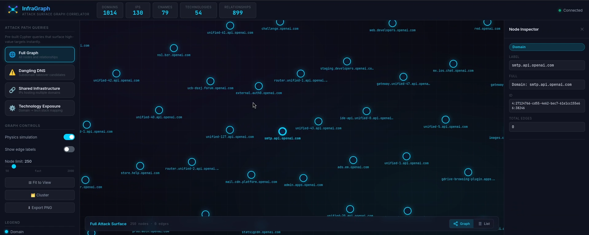
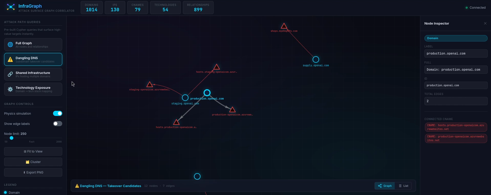
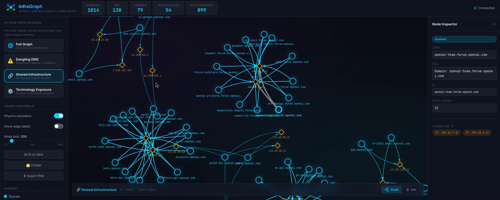
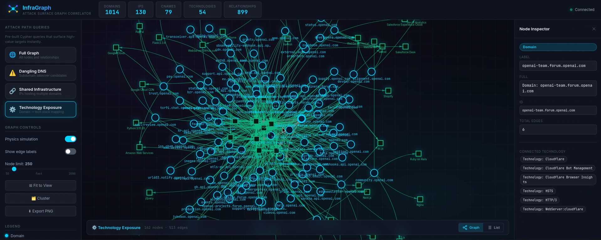

<div align="center">

# 🕸️ InfraGraph — Attack Surface Graph Correlator

**Turn hours of manual grep/awk into instant visual attack-path queries.**

[](https://go.dev)
[](https://neo4j.com)
[](https://visjs.org)
[](#-docker-one-command-setup)
[](#license)

InfraGraph is an **OSINT / Attack Surface Management** pipeline that ingests output from `subfinder`, `amass`, and `httpx`, builds a **relational graph** in Neo4j, and renders it as an interactive **vis.js** network — highlighting **dangling DNS**, **shared infrastructure**, and **technology exposure** in seconds.

---

> 

</div>

---

## 📋 Table of Contents

- [The Problem](#-the-problem)
- [Features](#-features)
- [Demo](#-demo)
- [Architecture](#-architecture)
- [Quick Start — Manual Install](#-quick-start--manual-install)
- [Quick Start — Docker (One-Command Setup)](#-docker-one-command-setup)
- [CLI Reference](#-cli-reference)
- [Web UI Guide](#-web-ui-guide)
- [Cypher Query Cookbook](#-cypher-query-cookbook)
- [Database Management](#-database-management)
- [Project Structure](#-project-structure)
- [Troubleshooting](#-troubleshooting)
- [Security & Ethics](#-security--ethics)
- [Contributing](#-contributing)
- [License](#license)

---

## 🎯 The Problem

Recon tools like Subfinder, Amass, and httpx output **flat text/JSON files**. Red teamers and bug bounty hunters waste hours manually cross-referencing data to find real attack paths:

```
mail.target.com   →  104.21.55.12
old.target.com    →  s3-website.amazonaws.com    ← ⚠️ Dangling DNS — takeover candidate!
api.target.com    →  104.21.55.12                ← 🔗 Shared infra with mail — origin leak!
cdn.target.com    →  Cloudflare (Wappalyzer)     ← ⚙️ Technology exposure
```

**InfraGraph eliminates this** by correlating all findings into a queryable graph and surfacing attack paths through one-click queries.

---

## ✨ Features

| Feature | Description |
|---------|-------------|
| 🔍 **Automated Recon** | Runs Subfinder + Amass concurrently, probes with httpx |
| 🕸️ **Graph Correlation** | Builds a Neo4j graph connecting domains, IPs, CNAMEs, and technologies |
| ⚠️ **Dangling DNS Detection** | Finds CNAME records pointing to cloud services that can be taken over |
| 🔗 **Shared Infrastructure** | Discovers IPs serving multiple domains — origin server leaks |
| ⚙️ **Technology Mapping** | Maps every domain to its detected tech stack (Nginx, React, etc.) |
| 🌐 **Interactive Web UI** | Dark-mode vis.js graph with click-to-query, search, and hover tooltips |
| 🐳 **Docker Support** | One-command deployment with all tools pre-installed |
| 📊 **Multiple Output Modes** | Full scan, ingest-only, serve-only, fresh re-scan, full reset |

---

## 🎬 Demo

> 🎥 **Demo Video**
> 

<!-- ADDITIONAL SCREENSHOTS -->
<details>
<summary>📸 <strong>Click to expand screenshots</strong></summary>
<br>

> **Graph View** — Full attack surface visualization
> 
> 
> **Dangling DNS** — Subdomain takeover candidates highlighted
> 
> 
> **Shared Infrastructure** — Origin server leak detection
> 
> 
> **Technology Exposure** — Tech stack mapping per domain
> 


</details>

---

## 🏗️ Architecture

```
                        ┌──────────────────────────────────────────────────────────┐
                        │                    InfraGraph Pipeline                   │
                        │                                                          │
  ┌────────────┐        │   ┌───────────┐                                          │
  │  Subfinder  │───────┼─▶│           │                                          │
  └────────────┘        │   │  Go       │    ┌──────────┐    ┌────────┐    ┌─────┐ │
  ┌────────────┐        │   │  Parser   │───▶│  Neo4j   │───▶│ Go API │───▶│ UI  │ │
  │   Amass    │────────┼─▶│  Engine   │    │  Graph   │    │ Server │    │vis.js│ │
  └────────────┘        │   │           │    │  Store   │    └────────┘    └─────┘ │
  ┌────────────┐        │   └───────────┘    └──────────┘                          │
  │   httpx    │────────┼─▶     │                 ▲                                │
  └────────────┘        │       ▼                 │                                │
                        │   output/*.json    bolt://7687                            │
                        └──────────────────────────────────────────────────────────┘
```

### Graph Schema

```
  ┌──────────┐  RESOLVES_TO   ┌──────┐
  │  Domain  │──────────────▶│  IP  │
  │          │                └──────┘
  │          │  HAS_CNAME     ┌───────┐
  │          │───────────────▶│ CNAME │
  │          │                └───────┘
  │          │  RUNS_ON       ┌────────────┐
  │          │───────────────▶│ Technology │
  │          │                └────────────┘
  │          │  HAS_TITLE     ┌───────────┐
  │          │───────────────▶│ HTTPTitle │
  └──────────┘                └───────────┘
```

| Node | Key Properties |
|------|---------------|
| `Domain` | `name`, `url`, `status_code`, `scheme` |
| `IP` | `address`, `asn`, `cidr`, `desc` |
| `CNAME` | `target` |
| `Technology` | `name` |
| `HTTPTitle` | `text` |

---

## 🚀 Quick Start — Manual Install

### Prerequisites

| Requirement | Version | Install |
|------------|---------|---------|
| **Go** | 1.26+ | [go.dev/dl](https://go.dev/dl/) |
| **Neo4j** | 5.x Community | [neo4j.com/download](https://neo4j.com/download/) or use the bundled `neo4j/` folder |
| **Java** | 21+ | `sudo apt install openjdk-21-jre` (required by Neo4j) |
| **Subfinder** | Latest | `go install github.com/projectdiscovery/subfinder/v2/cmd/subfinder@latest` |
| **httpx** | Latest | `go install github.com/projectdiscovery/httpx/cmd/httpx@latest` |
| **Amass** | v4.2.0+ | `sudo apt install amass` | [GitHub Releases](https://github.com/owasp-amass/amass/releases) (download pre-compiled binary, rename to `amass-v4`) |

> [!NOTE]
> On Kali Linux and some Debian systems, the system `httpx` package conflicts with the Go tool. InfraGraph handles this automatically by searching `~/go/bin/httpx` first, then falling back to `httpx-toolkit`.

### Step 1 — Clone & Build

```bash
git clone https://github.com/nmvishnu/InfraGraph.git
cd InfraGraph
make build
```

### Step 2 — Start Neo4j

**Option A — Use the bundled standalone Neo4j:**
```bash
./scripts/neo4j.sh start
```

This exposes:
- **Neo4j Browser:** http://localhost:7474
- **Bolt URI:** `bolt://localhost:7687`
- **Credentials:** `neo4j` / `infragraph`

### Step 3 — Run a Scan

```bash
make run TARGET=example.com
```

### Step 4 — Explore the Graph

Open **http://localhost:8080** in your browser.

---

## 🐳 Docker (One-Command Setup)

The Docker setup bundles **everything** — Go binary, Subfinder, httpx, Amass, and Neo4j — so you don't need to install anything except Docker.

### Build

```bash
./docker/run.sh build
```
### Start the full stack

```bash
./docker/run.sh up
# Web UI  → http://localhost:8080
```

### Run a Scan

```bash
./docker/run.sh scan example.com
```

### All Docker Commands

| Command | Description |
|---------|-------------|
| `./docker/run.sh build` | Build the Docker image |
| `./docker/run.sh up` | Start Neo4j + InfraGraph UI |
| `./docker/run.sh scan <domain>` | Run a full scan |
| `./docker/run.sh scan <domain> -timeout 5` | Scan with custom timeout |
| `./docker/run.sh ingest` | Re-ingest existing output files |
| `./docker/run.sh down` | Stop all containers |
| `./docker/run.sh logs` | Follow container logs |
| `./docker/run.sh status` | Show container status |
| `./docker/run.sh clean` | Remove containers, volumes, and images |

### Pinned Tool Versions (Docker)

| Tool | Version |
|------|---------|
| Go | 1.26 |
| Neo4j | 5.26.8 Community |
| Subfinder | v2.14.0 |
| httpx | v1.9.0 |
| Amass | v4.2.0 |

> [!TIP]
> To use Subfinder API keys inside Docker, place your `provider-config.yaml` in `~/.config/subfinder/` before building. The build script copies it automatically.

---

## ⌨️ CLI Reference

```
Usage: infragraph [flags]

Flags:
  -target string     Target domain to enumerate (e.g. example.com)
  -output string     Directory for raw JSON outputs (default: "output")
  -neo4j  string     Neo4j bolt URI (default: "bolt://localhost:7687")
  -user   string     Neo4j username (default: "neo4j")
  -pass   string     Neo4j password (default: "infragraph")
  -listen string     API/UI server address (default: ":8080")
  -web    string     Static web root directory (default: "web")
  -timeout string    Amass timeout in minutes (default: "30")

Modes:
  -ingest-only       Skip recon, only ingest existing JSON files
  -serve-only        Skip recon and ingestion, only serve the UI

Data Management:
  -fresh             Delete all nodes for -target before re-ingesting
  -reset             Wipe the ENTIRE graph database before ingesting
```

### Usage Examples

```bash
# Full scan against a target
./build/infragraph -target hackerone.com

# Quick scan with shorter Amass timeout (5 minutes)
./build/infragraph -target example.com -timeout 5

# Re-scan a target (wipe old data for this domain first)
./build/infragraph -target example.com -fresh

# Nuclear option — wipe entire database and start fresh
./build/infragraph -target example.com -reset

# Re-ingest after manually editing output JSON files
./build/infragraph -ingest-only -output ./output

# Just view the existing graph (no scanning)
./build/infragraph -serve-only

# Connect to a remote Neo4j instance
./build/infragraph -target example.com -neo4j bolt://10.0.0.5:7687 -pass s3cret

# Use the Makefile shortcuts
make run TARGET=example.com
make ingest
make serve
```

---

## 🌐 Web UI Guide

The web UI is accessible at **http://localhost:8080** after starting InfraGraph.

### Sidebar Query Buttons

| Button | Query | What It Finds |
|--------|-------|---------------|
| 🌐 **Full Graph** | All nodes & edges | Complete attack surface visualization |
| ⚠️ **Dangling DNS** | Orphaned CNAMEs | Subdomain takeover candidates pointing to unclaimed cloud resources |
| 🔗 **Shared Infrastructure** | Multi-homed IPs | IPs serving multiple domains — origin server leaks |
| ⚙️ **Technology Exposure** | Tech stack map | Domain → technology relationships (Nginx, React, WordPress, etc.) |
| 🏠 **IP Addresses** | IP listing | All discovered IP addresses with ASN data |

### Interaction

- **Click** a node to highlight its connections
- **Hover** over any node to see detailed properties in the tooltip
- **Scroll** to zoom in/out
- **Drag** nodes to rearrange the layout
- **Search** by domain name using the search bar

---

## 📊 Cypher Query Cookbook

Run these directly in the **Neo4j Browser** at `http://localhost:7474`:

<details>
<summary><strong>⚠️ Dangling DNS — Subdomain Takeover Candidates</strong></summary>

```cypher
MATCH (d:Domain)-[:HAS_CNAME]->(c:CNAME)
WHERE NOT (d)-[:RESOLVES_TO]->(:IP)
  AND c.target =~ '.*(amazonaws\\.com|azure.*\\.net|cloudapp\\.net|herokuapp\\.com|github\\.io|shopify\\.com|fastly\\.net|pantheon\\.io|ghost\\.io|myshopify\\.com|zendesk\\.com|surge\\.sh|bitbucket\\.io|wordpress\\.com|smugmug\\.com|ghost\\.org|helpjuice\\.com|helpscoutdocs\\.com|s3\\.amazonaws\\.com|animaapp\\.io|readme\\.io|cargocollective\\.com|statuspage\\.io|tumblr\\.com|ghost\\.io|aha\\.io|brightcove\\.com|bigcartel\\.com|campaignmonitor\\.com|acquia-test\\.co|proposify\\.com|simplebooklet\\.com|getresponse\\.com|vend\\.com|aftership\\.com|freshdesk\\.com|helpjuice\\.com|helpscoutdocs\\.com|groove\\.hq|thinkific\\.com|teachable\\.com|tictail\\.com).*'
RETURN d.name AS subdomain, c.target AS dangling_cname
ORDER BY c.target
```

</details>

<details>
<summary><strong>🔗 Shared Infrastructure — Origin Server Leaks</strong></summary>

```cypher
MATCH (d1:Domain)-[:RESOLVES_TO]->(i:IP)<-[:RESOLVES_TO]-(d2:Domain)
WHERE d1.name < d2.name
RETURN d1.name AS domain_1, i.address AS shared_ip, d2.name AS domain_2
ORDER BY i.address
```

</details>

<details>
<summary><strong>⚙️ Technology Fingerprinting</strong></summary>

```cypher
MATCH (d:Domain)-[:RUNS_ON]->(t:Technology)
RETURN d.name AS domain, collect(t.name) AS tech_stack
ORDER BY size(collect(t.name)) DESC
```

</details>

<details>
<summary><strong>📊 Attack Surface Summary</strong></summary>

```cypher
MATCH (n)
RETURN labels(n)[0] AS node_type, count(n) AS count
ORDER BY count DESC
```

</details>

<details>
<summary><strong>🔍 Find All Subdomains for a Specific IP</strong></summary>

```cypher
MATCH (d:Domain)-[:RESOLVES_TO]->(i:IP {address: '104.21.55.12'})
RETURN d.name AS subdomain, d.url AS url, d.status_code AS status
ORDER BY d.name
```

</details>

---

## 🗄️ Database Management

### Reset Database (Wipe All Scan Data)

```bash
# Option 1 — Using the helper script
./scripts/neo4j.sh reset

# Option 2 — Manual reset
./scripts/neo4j.sh stop          # or: pkill -f neo4j
rm -rf neo4j/data/databases
rm -rf neo4j/data/transactions
neo4j/bin/neo4j-admin dbms set-initial-password infragraph
./scripts/neo4j.sh start
```

### Delete Only Raw Output Files

```bash
rm -rf output/
```

### Re-scan a Single Target (Keep Other Data)

```bash
./build/infragraph -target example.com -fresh
```

---

## 📁 Project Structure

```
InfraGraph/
├── cmd/
│   └── infragraph/
│       └── main.go                 # CLI entry point & flag parsing
├── internal/
│   ├── api/
│   │   └── server.go               # HTTP API + static file server
│   ├── graph/
│   │   ├── client.go               # Neo4j driver & session management
│   │   ├── ingest.go               # Cypher MERGE ingestion logic
│   │   └── queries.go              # Pre-built graph query functions
│   ├── parser/
│   │   ├── subfinder.go            # Subfinder JSON output parser
│   │   ├── amass.go                # Amass JSON output parser
│   │   └── httpx.go                # httpx JSON output parser
│   └── runner/
│       └── runner.go               # OSINT tool orchestration
├── web/
│   ├── index.html                  # Main UI (vis.js network graph)
│   ├── app.js                      # Graph rendering & API integration
│   └── style.css                   # Dark-mode glassmorphism theme
├── docker/
│   ├── Dockerfile                  # Multi-stage build (Go + tools)
│   ├── docker-compose.yml          # Full stack (Neo4j + InfraGraph)
│   ├── run.sh                      # Docker helper script
│   └── README.md                   # Docker-specific documentation
├── scripts/
│   ├── neo4j.sh                    # Neo4j start/stop/reset helper
│   └── seed-demo.sh                # Seed demo data for testing
├── neo4j/                          # Bundled Neo4j Community Edition
├── output/                         # Raw JSON scan outputs (gitignored)
├── Makefile                        # Build, run, and manage shortcuts
├── requirements.txt                # External tool requirements
├── go.mod
├── go.sum
└── README.md
```

---

## 🔧 Troubleshooting

<details>
<summary><strong>Neo4j won't start — "Address already in use"</strong></summary>

Another process is using port 7474 or 7687. Find and stop it:
```bash
sudo lsof -i :7474
sudo lsof -i :7687
# Then kill the process or stop the other Neo4j instance
```

</details>

<details>
<summary><strong>httpx not found / wrong httpx version</strong></summary>

On some systems (especially Kali), the system `httpx` is a Python package, not the Go security tool. Install the correct one:
```bash
go install github.com/projectdiscovery/httpx/cmd/httpx@latest
```
InfraGraph looks for `~/go/bin/httpx` first, then `httpx-toolkit`, then falls back to `httpx` in PATH.

</details>

<details>
<summary><strong>Docker build fails with "stream error" or "INTERNAL_ERROR"</strong></summary>

This is a transient network error from the Go module proxy. The Docker image now downloads **pre-compiled binaries** instead of compiling from source, which avoids this issue. Make sure you're using the latest Dockerfile.

</details>

<details>
<summary><strong>"0 IPs found" or empty graph</strong></summary>

- Verify Neo4j is running: `./scripts/neo4j.sh status`
- Check that output files exist and contain data: `ls -la output/`
- Try re-ingesting: `make ingest`

</details>

<details>
<summary><strong>UI loads but graph is empty</strong></summary>

Click the **"Full Graph"** button in the sidebar. The graph doesn't auto-load to prevent accidental queries on large datasets.

</details>

---

## 🔒 Security & Ethics

> [!CAUTION]
> Only scan domains you **own** or have **explicit written permission** to test.

- Respect bug bounty program scope definitions
- Output files in `output/` may contain sensitive infrastructure data — treat accordingly
- The Neo4j database stores a complete map of discovered assets — secure access appropriately
- API keys stored in `~/.config/subfinder/provider-config.yaml` are sensitive credentials

---

## 🎯 Target Users

| Audience | Use Case |
|----------|----------|
| 🔴 **Red Teams** | Map client external attack surfaces before engagements |
| 🐛 **Bug Bounty Hunters** | Find takeover targets and hidden origin servers fast |
| 🏢 **ASM Engineers** | Continuous visibility into forgotten external assets |
| 🎓 **Security Researchers** | Graph-based analysis of internet infrastructure |

---

## 🤝 Contributing

Contributions are welcome! Here's how to get started:

1. **Fork** the repository
2. **Create** a feature branch (`git checkout -b feature/amazing-feature`)
3. **Commit** your changes (`git commit -m 'Add amazing feature'`)
4. **Push** to the branch (`git push origin feature/amazing-feature`)
5. **Open** a Pull Request

### Areas for Contribution

- [ ] Additional OSINT tool integrations (e.g., `dnsx`, `naabu`)
- [ ] Export graph data as CSV/JSON from the UI
- [ ] Historical scan comparison (time-travel slider)
- [ ] Additional graph queries and attack path patterns
- [ ] CI/CD pipeline and automated testing

---

## 📄 License

This project is licensed under the **MIT License** — see the [LICENSE](LICENSE) file for details.

---

<div align="center">

**Built with ❤️ using Go, Neo4j, and vis.js**

[⬆ Back to Top](#️-infragraph--attack-surface-graph-correlator)

</div>
